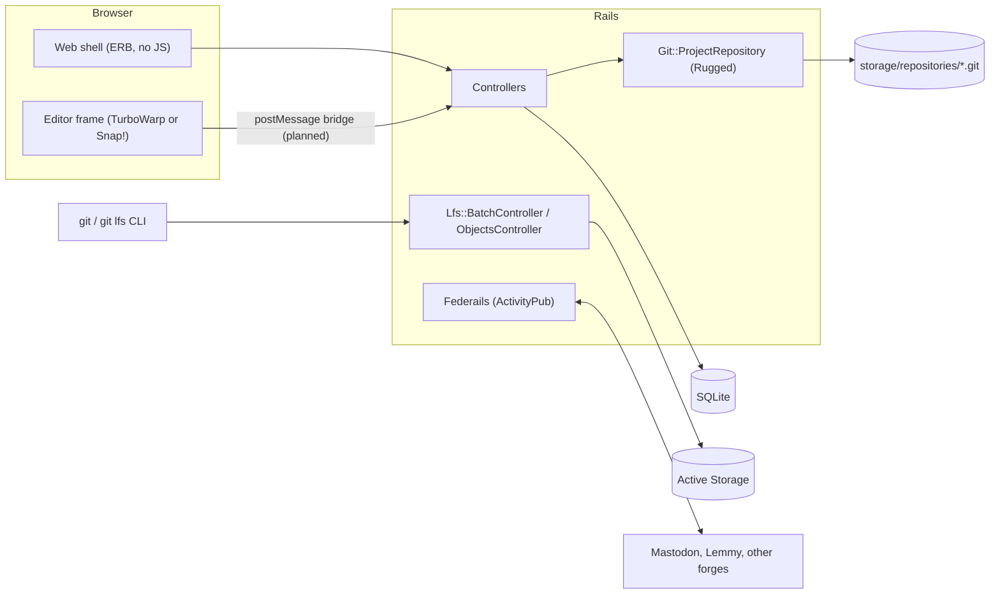

# Architecture

NostalgiaKit is a forge for Scratch and Snap! projects. Each project is a Git
repository: its source is plain text, so branches, commits and merge proposals
work the way they do for code.

## Web shell

Every page except the editor is server-rendered ERB with no JavaScript
(`layouts/application`). Project pages nest `layouts/project` inside it for the
header, tabs and side column. The look mixes Launchpad (warm neutrals, 1px
borders, dense two-column layouts, orange accents) with the Scratch 2.0 blue top
bar. Icons are Tango (`tango_icon` in `ApplicationHelper`).

URLs follow Launchpad: `/~alice/platformer`, `/~alice/platformer/+bugs/12`,
`/~alice/platformer/+merges/3`, `/~alice/platformer/+specs/level-editor`.

## Editors

`EditorsController` uses `layouts/editor` and frames a prebuilt editor from
`public/editors/`. The editors themselves live under `editors/`, fenced off
because of their licenses (see `editors/README.md`).

## Storage

| What | Where | Why |
| --- | --- | --- |
| `project.json` (Scratch), `project.xml` (Snap!) | Git, via Rugged | Clean diffs, branches and merges |
| Costumes and sounds | Active Storage, one `LfsObject` per SHA-256 | Deduplicated across every project |
| Asset references in Git | Git LFS pointer files (`Git::LfsPointer`) | `git clone` plus `git lfs pull` works |
| Metadata (users, bugs, merges, blueprints, forums) | SQLite via Active Record | |

Vanilla Scratch names assets by MD5, so `LfsObject` stores the MD5 too and
`Sb3::Exporter` renames assets on the way out.

## Collaboration

No live multiplayer editing. Remixing forks the repository; changes come back as
merge proposals (`PullRequest`). Bugs (`Issue`) and blueprints (`Blueprint`)
use Launchpad's statuses.

## Federation

See `federation.md`.
