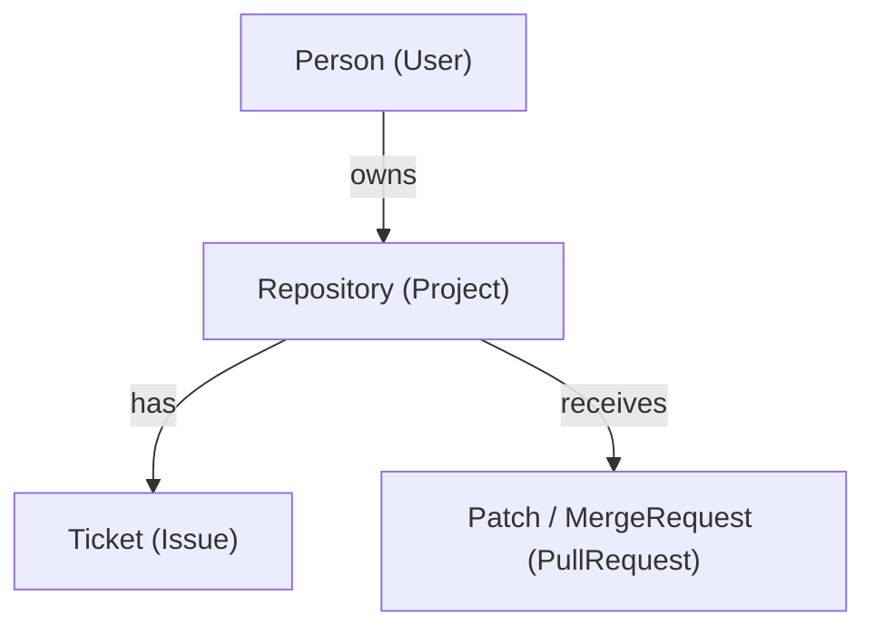

# Federation

## Phase 1: ActivityPub through federails

[federails](https://gitlab.com/experimentslabs/federails) is mounted at `/` and
configured in `config/federails.yml`. Users become ActivityPub `Person` actors,
so people on Mastodon, Lemmy and similar platforms can follow creators, boost
releases and reply to comments.

Not done yet: `acts_as_federails_actor` on `User`, and publishing activities
for new projects, releases and comments.

## Phase 2: ForgeFed

[ForgeFed](https://forgefed.org/spec/) adds forge vocabulary on top of the same
actors. Code lives in `app/services/forge_fed/` once it starts.

Goals: forks across instances, merge proposals from a remix on another
instance, and Launchpad-style remote bug watches.
